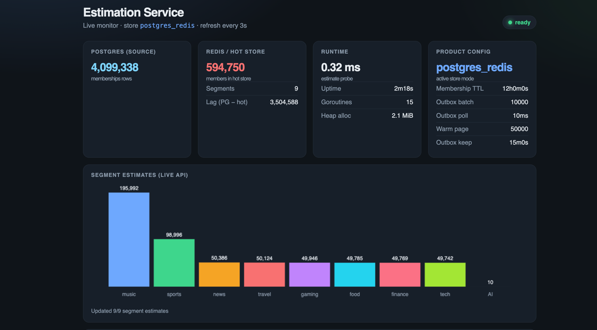

# Estimation Service (Go Challenge)



Answers: **how many users are in segment X?**  
A user stays in a segment for **two weeks** after being tagged; expired memberships are not counted.

Live health dashboard: `GET /v1/health` in a browser (Postgres vs Redis totals, lag, per-segment estimates).

Architecture:


## Quick start

```bash
cp .env.example .env   # once — edit ports, store, TTL, etc.

# full stack (Postgres + Redis + estimator with outbox worker)
# compose reads .env; defaults use docker hostnames (redis/postgres)
docker compose up --build -d

# or run locally (reads .env; use localhost Redis/Postgres)
go run ./cmd/estimator
go run ./cmd/uss

# browser dashboard
open http://localhost:8080/v1/health

curl -s -H 'Accept: application/json' localhost:8080/v1/health
curl -s localhost:8080/v1/segments/sports/estimate

# rebuild hot store (memory/redis: flush; postgres_redis: pause outbox, discard pending, flush + warm from DB)
curl -s -X POST -H "X-Admin-Token: $ADMIN_TOKEN" localhost:8080/v1/admin/reset
```

Load test (multi-million):

```bash
USS_EVENTS=3000000 USS_WORKERS=64 USS_TIMEOUT=2h USS_GRPC_ADDR=localhost:9090 go run ./cmd/uss
```

```bash
go test ./...
```

### Configuration (`.env`)

See [`.env.example`](./.env.example). Important keys:

| Key | Default | Meaning |
|-----|---------|---------|
| `HTTP_ADDR` | `:8080` | REST listen address |
| `GRPC_ADDR` | `:9090` | gRPC ingest listen address |
| `STORE` | `memory` | `memory` \| `redis` \| `postgres_redis` |
| `REDIS_ADDR` | `localhost:6379` | Redis host (`redis:6379` inside compose) |
| `DATABASE_URL` | _(required for postgres_redis)_ | Postgres DSN (`…@postgres:5432…` inside compose) |
| `MEMBERSHIP_TTL` | `14d` | How long a tag stays active (`14d` or `336h`) |
| `ADMIN_TOKEN` | `dev-admin-token` | Token for `POST /v1/admin/reset` |
| `OUTBOX_POLL_INTERVAL` | `100ms` | Outbox → Redis poll when idle (busy drain skips wait) |
| `OUTBOX_BATCH_SIZE` | `1000` | Outbox claim batch size |
| `OUTBOX_CLEANUP_INTERVAL` | `1m` | How often to delete processed outbox rows |
| `OUTBOX_CLEANUP_RETENTION` | `15m` | Keep processed outbox rows at least this long |
| `OUTBOX_CLEANUP_BATCH` | `10000` | Max processed rows deleted per cleanup tick |
| `WARM_PAGE_SIZE` | `50000` | Memberships loaded per SQL page during admin reset warm |
| `USS_GRPC_ADDR` | `localhost:9090` | Where `cmd/uss` dials |
| `USS_WORKERS` | `8` | Concurrent USS workers |
| `USS_EVENTS` | `1000` | How many ingest RPCs to send |
| `USS_TIMEOUT` | `30m` | USS client deadline |

`docker-compose.yml` interpolates these from `.env` (`${VAR:-default}`). For compose, prefer `STORE=postgres_redis`, `REDIS_ADDR=redis:6379`, and `DATABASE_URL=…@postgres:5432…` — `localhost` only works for host-run processes.

### Store modes

| `STORE` | Ingest | Estimate |
|---------|--------|----------|
| `memory` | RAM map | RAM |
| `redis` | Direct Redis (`ZADD` refreshes score/TTL window) | Redis |
| `postgres_redis` | Postgres + transactional outbox; async worker → Redis | Redis (SQL fallback if Redis errors) |

## API

### Ingest (gRPC) — from USS

- Service: `segment.v1.MembershipService`
- RPC: `Ingest({ user_id, segment }) → {}`
- Proto: [`api/proto/segment/v1/membership.proto`](api/proto/segment/v1/membership.proto)
- Invalid input → `InvalidArgument`

### Estimate (REST)

```http
GET /v1/segments/{segment}/estimate
```

```json
{"segment":"sports","count":42}
```

- Empty segment → `400`
- While resetting → `503` `{"error":"system is resetting; hot store is being rebuilt","status":"resetting"}` (never a wrong count)
- Unexpected failure → `500`

### Health

```http
GET /v1/health
```

Browser → HTML live monitor (Postgres source count, Redis/hot members, lag, runtime probe, per-segment estimate charts; refreshes every 3s).  
`Accept: application/json` or `?format=json` → JSON with the same fields (`source_members`, `segment_names`, …).

- `ready` → `200`
- `resetting` → `503`

### Admin reset

```http
POST /v1/admin/reset
X-Admin-Token: <ADMIN_TOKEN>
```

| Store | Behaviour |
|-------|-----------|
| `memory` / `redis` | Flush hot store synchronously → `200` `ready` |
| `postgres_redis` | Pause outbox, discard pending, flush Redis, warm from memberships **async**, resume → `202` `resetting` until done |

Concurrent reset → `409`. Missing/invalid token → `401`.

## Design choices

| Choice | Why |
|--------|-----|
| **gRPC for ingest** | Service-to-service from USS; explicit protobuf contract; easy to add streaming later under load |
| **REST for estimate** | Simple read; easy to call with curl/browser; cache-friendly |
| **Hexagonal + package-by-domain** | `internal/segment` owns model, ports, service; adapters under `adapter/{http,grpc,memory}` |
| **`STORE` strategies** | Same `Repository` port; swap at composition root without touching HTTP/gRPC/domain |
| **Redis sorted set** `segment:{name}` score=`taggedAt` | Ingest `ZADD GT` (never regress score); estimate `ZCOUNT` + prune expired — fits TTL + per-segment scale |
| **Postgres + transactional outbox** | Durable history in Postgres; Redis is a projection. Outbox in the same TX beats “write Redis then failure table” |
| **In-process outbox worker** | Pipelined Redis writes + batch mark-done; busy-drain when the queue is non-empty |
| **Admin reset (no boot warm/flush)** | Startup stays fast; `POST /v1/admin/reset` rebuilds the hot store; estimate returns `503` while resetting |
| **No GORM (raw SQL)** | Two tables + outbox/`SKIP LOCKED` are clearer and lighter without an ORM; keeps GORM models out of the domain |
| **Indexes, not sharding (yet)** | Hot path is Redis per segment. Postgres has PK `(user_id,segment)` + `(segment,tagged_at)` for fallbacks. Shard/partition later if history grows huge |
| **Injected `Clock`** | Two-week expiry is unit-testable without sleeping |
| **TDD** | Behaviour covered next to the code (`*_test.go`) |

Membership rule: active while `now - taggedAt < TTL`. Re-ingest of the same user/segment refreshes the window.

### Scale (millions of users)

- **Estimate:** Redis `ZCOUNT` on `segment:{name}` — work is proportional to one segment, not the whole user base. Hundreds of segments ⇒ hundreds of keys; no Redis Cluster required for the challenge.
- **Ingest:** O(1)/O(log n) upserts to Redis; Postgres upsert by primary key.
- **Indexes we rely on:** `(user_id, segment)` PK; `(segment, tagged_at DESC)` for SQL count/warm; partial outbox index for claims.
- **Sharding:** not needed now. If Postgres history becomes huge, partition by `segment` or time and/or prune expired memberships; Redis can move to Cluster with hash-tagged keys later.
- **Outbox retention:** in-process cleaner deletes processed rows older than `OUTBOX_CLEANUP_RETENTION` in batches.
- **Reset warm:** keyset-paged `ListActivePage` + Redis pipelines — does not load all active rows into one Go slice.

### Known trade-offs (called out on purpose)

These are conscious for the challenge scope; not forgotten:

1. **No automatic boot warm.** With `STORE=postgres_redis`, a fresh Redis (or wiped volume) starts `ready` with an empty hot cache while Postgres still holds history. New ingests refill via outbox; **full rebuild is `POST /v1/admin/reset`**. That keeps startup fast and avoids multi-million warm on every boot.
2. **Async warm failure currently logs and still becomes `ready`.** Ideal follow-up: stay `resetting` / degraded so estimate cannot serve undercounts with `200` (see `TODO` in `Service.Reset`). Until then, check logs after reset if Redis looks incomplete.

## Layout

```
cmd/estimator/          # wires adapters + starts HTTP & gRPC
cmd/uss/                # load/simulator client
api/proto/segment/v1/   # protobuf source
internal/config/        # .env / env loading
internal/segment/       # domain + ports + service
  adapter/http/         # REST estimate + health HTML
  adapter/grpc/         # gRPC ingest (+ gen/)
  adapter/memory/       # in-memory repository
  adapter/redis/        # Redis sorted-set repository
  adapter/postgres/     # memberships + outbox tables
  adapter/postgresredis/# dual store + outbox worker
```

## AI usage

See [`ai.md`](./ai.md). (`sample.ai.md` is the template only.)

## Original challenge brief

The upstream problem statement lives in git history / the fork source ([ArmanCreativeSolutions/go-challenge](https://github.com/ArmanCreativeSolutions/go-challenge)). This README focuses on the implemented solution.
